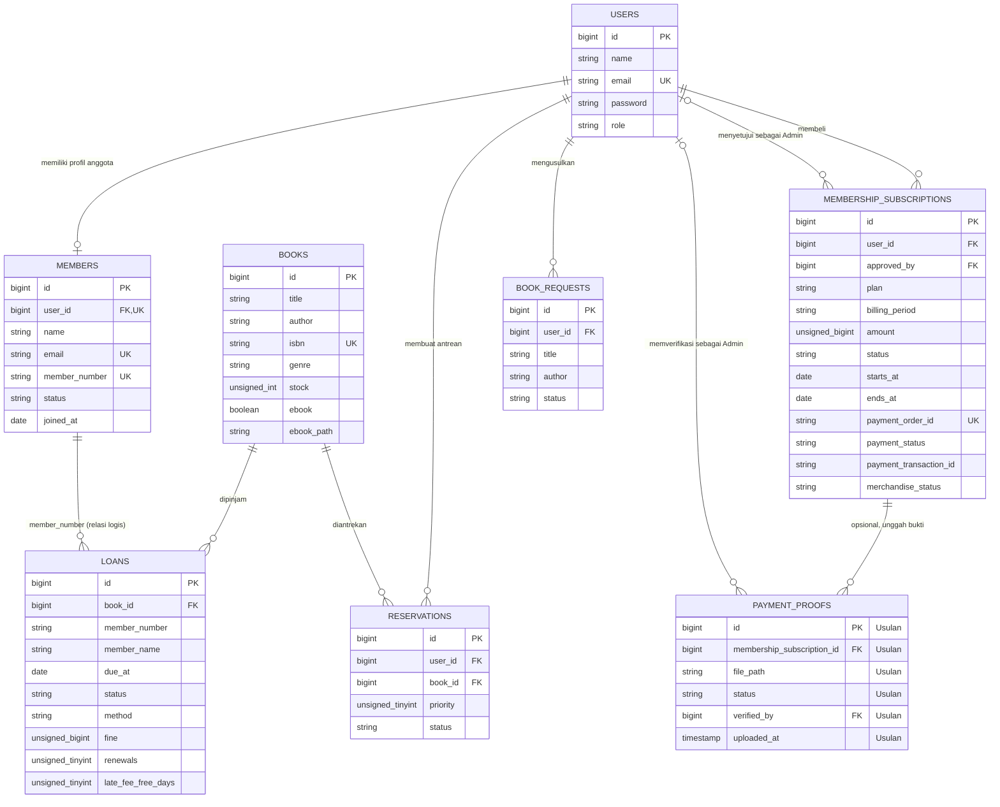
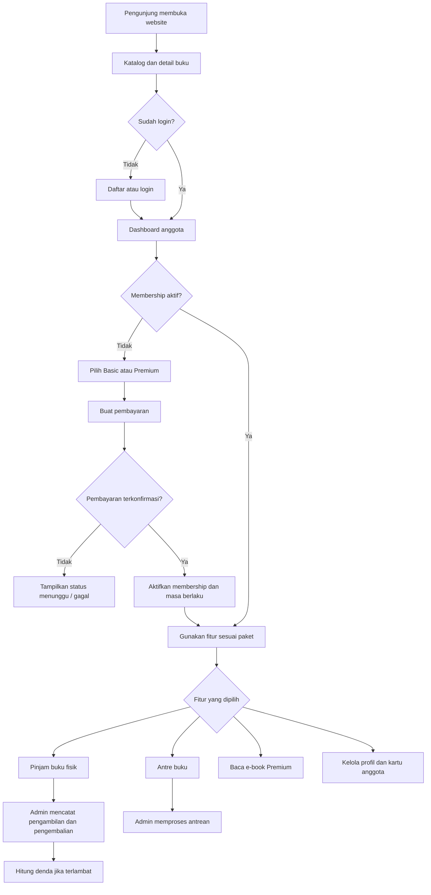
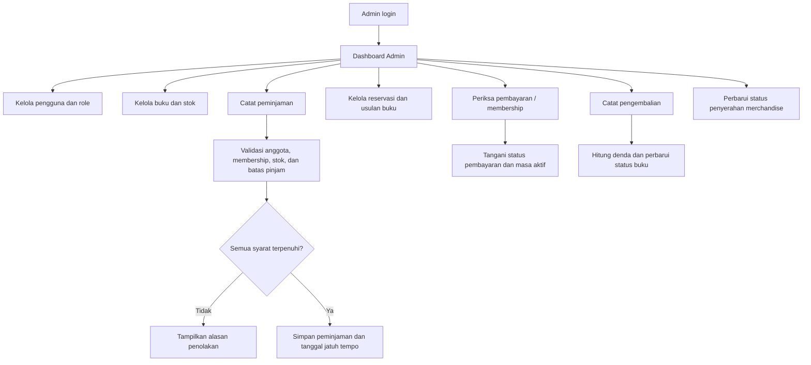
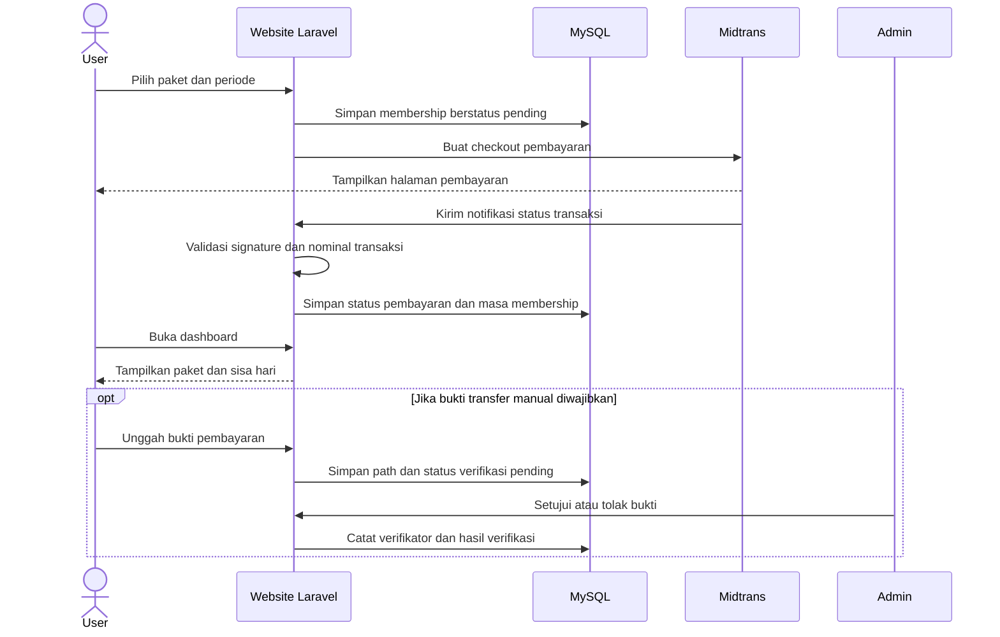

# Dokumentasi Ujian Akhir — Website Perpustakaan Peminjaman Buku

**Nama proyek:** Ruang Baca / Leona Bookstore  
**Tujuan:** Website perpustakaan dengan katalog buku, keanggotaan Basic dan Premium, peminjaman buku fisik, e-book untuk anggota Premium, serta panel Admin.  
**Stack:** PHP 8.3, Laravel 13, MySQL (target deployment), Blade, Tailwind CSS 4, Vite, dan Midtrans untuk pembayaran online.

> Dokumen ini memisahkan kebutuhan ujian dari kondisi kode saat ini. Beberapa kebutuhan sudah tersedia, sedangkan kebijakan denda dan bukti pembayaran masih berbeda dan perlu disepakati sebelum implementasi final.

## 1. Tujuan dan ruang lingkup

### Tujuan

1. Memudahkan pelanggan mencari buku dan mengetahui ketersediaan stok.
2. Mengelola keanggotaan, peminjaman, pengembalian, perpanjangan, dan denda.
3. Membatasi fitur berdasarkan role dan paket membership.
4. Memberi Admin alat untuk mengelola buku, pengguna, transaksi, antrean, dan merchandise.
5. Menyediakan pembaca e-book privat khusus anggota Premium.

### Role

| Role | Hak akses utama |
|---|---|
| **Admin** | Mengelola pengguna dan role, buku dan stok, peminjaman/pengembalian, membership, pembayaran, antrean, usulan buku, dan status merchandise. |
| **User / Anggota** | Melihat katalog, mengelola profil, membeli membership, meminjam atau mengantre buku, melihat masa membership, membaca e-book jika memenuhi syarat, dan mengirim usulan buku. |

## 2. Aturan bisnis membership

| Fitur | Basic | Premium |
|---|---:|---:|
| Harga bulanan | Rp29.000 | Rp49.000 |
| Maksimum peminjaman aktif | 3 buku | 7 buku |
| Masa pinjam per buku | 14 hari | 21 hari |
| Peminjaman buku fisik | Ya, melalui perpustakaan | Ya, melalui perpustakaan |
| Akses e-book | Tidak | Ya, melalui reader di aplikasi |
| Prioritas antrean | Tidak | Ya |
| Merchandise | Merchandise tahunan sesuai ketentuan | Merchandise tahunan sesuai ketentuan |
| Perpanjangan gratis | Satu kali; jumlah hari harus ditetapkan | Tambahan 2 hari sesuai kebutuhan ujian |

Membership tahunan dapat ditawarkan sebagai pilihan diskon. Konfigurasi aplikasi saat ini memakai Rp290.000/tahun untuk Basic dan Rp490.000/tahun untuk Premium (setara 10 bulan pembayaran bulanan).

### Kebijakan yang wajib dipastikan

- **Perpanjangan Basic:** kebutuhan menyebut perpanjangan gratis setelah 14 hari, tetapi jumlah hari dan apakah dapat dilakukan berulang belum ditentukan. Kode saat ini mengizinkan satu kali perpanjangan selama 7 hari. Sesuaikan aturan setelah kebijakan ujian disepakati.
- **Perpanjangan Premium:** kebutuhan menyebut tambahan gratis 2 hari. Pastikan apakah 2 hari merupakan perpanjangan satu kali atau periode toleransi keterlambatan.
- **Denda:** kebutuhan ujian menyebut Rp2.000 per jam. Tentukan apakah jam parsial dibulatkan ke atas dan kapan denda dianggap lunas. Implementasi saat ini menghitung Rp1.000 per hari setelah masa bebas denda yang berlaku untuk membership tahunan; ini **belum sesuai** kebutuhan Rp2.000/jam.
- **Pembayaran:** kebutuhan meminta unggah bukti pembayaran. Implementasi saat ini memakai Midtrans dan konfirmasi status melalui notifikasi pembayaran; belum tersedia unggah bukti transfer manual. Pilih salah satu sebagai sumber bukti resmi, atau tambahkan alur verifikasi bukti manual.
- **Antrean:** kebutuhan menyebut fitur opsional. Antrean dan prioritas Premium sudah tersedia dalam implementasi saat ini.
- **Merchandise:** tetapkan daftar hadiah per tahun, periode kelayakan, dan cara Admin menandai hadiah telah diserahkan.

## 3. Status fitur pada aplikasi saat ini

| Area | Kondisi implementasi |
|---|---|
| Role Admin dan Anggota | Tersedia; role disimpan pada akun pengguna. |
| Katalog, stok, dan data buku | Tersedia; Admin dapat mengelola buku, stok, dan metadata e-book. |
| Paket Basic/Premium dan harga | Tersedia; nilai paket dikonfigurasi di `config/membership.php`. |
| Masa aktif membership | Tersedia melalui tanggal mulai dan berakhir; sisa hari dapat ditampilkan dari tanggal berakhir. |
| Pinjam/kembali dan denda | Tersedia; aturan denda yang berjalan saat ini berbeda dari kebutuhan ujian (lihat bagian 2). |
| Pembayaran membership | Tersedia melalui Midtrans Snap dan webhook; tidak menggunakan bukti transfer yang diunggah. |
| Pembaca e-book | Tersedia untuk membership Premium aktif; file disimpan pada disk privat. Akses web tidak dapat menjamin DRM atau mencegah semua bentuk penyalinan layar. |
| Antrean reservasi | Tersedia; antrean Premium diprioritaskan. |
| Kartu anggota | Kartu anggota digital/QR tersedia. |
| Bukti pembayaran manual | Belum tersedia. |

## 4. Struktur proyek

Struktur penting yang sudah digunakan proyek:

```text
app/
├── Console/Commands/       # Perintah Artisan, termasuk promosi Admin
├── Http/
│   ├── Controllers/        # Alur web, admin, membership, e-book, reservasi
│   └── Middleware/         # Proteksi route Admin
├── Models/                 # User, Member, Book, Loan, MembershipSubscription, dll.
├── Providers/
└── Services/               # Logika antrean dan integrasi Midtrans
bootstrap/                   # Bootstrap Laravel
config/                      # Konfigurasi aplikasi dan membership
database/
├── factories/
├── migrations/              # Skema basis data dan perubahan skema
└── seeders/                 # Data awal/demo
public/                      # Entry point dan aset publik
resources/
├── css/                     # Tailwind CSS
├── js/                      # JavaScript dan interaksi katalog
└── views/                   # Blade: katalog, profil, Admin, reader, dll.
routes/
├── console.php
└── web.php                  # Route publik, anggota, dan Admin
storage/                     # File privat dan log aplikasi
tests/                       # PHPUnit: feature dan unit tests
```

Komponen terkait yang sering disentuh:

- `routes/web.php` — definisi route katalog, autentikasi, membership, pinjam, dan Admin.
- `config/membership.php` — harga, batas pinjaman, durasi, akses e-book, dan prioritas antrean.
- `app/Services/ReservationQueue.php` — aturan menyiapkan antrean buku.
- `app/Services/MidtransSnapClient.php` dan `app/Http/Controllers/MidtransWebhookController.php` — checkout dan konfirmasi pembayaran.
- `resources/css/app.css` — entry CSS Tailwind v4; memakai `@import 'tailwindcss';`.
- `resources/views/` — halaman antarmuka berbasis Blade.

## 5. Rancangan basis data

Diagram berikut menggambarkan tabel domain yang digunakan aplikasi. `payment_proofs` adalah **usulan tabel tambahan** jika bukti transfer manual diwajibkan; tabel tersebut belum ada pada implementasi saat ini.



### Catatan skema

- Satu akun `users` dapat memiliki paling banyak satu profil `members`; profil anggota menyimpan nomor anggota.
- `loans.member_number` saat ini mengacu secara logis pada `members.member_number`, tetapi belum memiliki foreign key basis data. Untuk penguatan integritas, pertimbangkan migrasi ke `loans.member_id`.
- Detail transaksi Midtrans saat ini berada di `membership_subscriptions`; pembayaran tidak memiliki tabel terpisah.
- File e-book dan bukti pembayaran harus disimpan di disk privat. Simpan path file di basis data, bukan konten file.
- Tabel `PAYMENT_PROOFS` hanya dibutuhkan jika alur unggah bukti manual menjadi keputusan final.
- Tabel `contact_messages`, `jobs`, `cache`, dan `sessions` tidak ditampilkan agar diagram fokus pada domain perpustakaan.

## 6. Alur website / aplikasi



### Alur Admin



### Alur pembayaran dan membership



## 7. Langkah-langkah pengembangan

### Langkah 1 — Siapkan lingkungan

1. Pastikan PHP 8.3+, Composer, Node.js, dan npm tersedia.
2. Pasang dependensi PHP dan JavaScript:

   ```powershell
   composer install
   npm.cmd install
   ```

3. Salin `.env.example` menjadi `.env` hanya jika `.env` belum ada, lalu buat application key:

   ```powershell
   Copy-Item .env.example .env
   php artisan key:generate
   ```

   Jangan menimpa `.env` yang sudah berisi konfigurasi lokal. Jangan commit `.env` atau kredensial.

### Langkah 2 — Konfigurasikan MySQL

1. Buat database MySQL, misalnya `ruang_baca`.
2. Atur koneksi pada `.env` lokal:

   ```dotenv
   DB_CONNECTION=mysql
   DB_HOST=127.0.0.1
   DB_PORT=3306
   DB_DATABASE=ruang_baca
   DB_USERNAME=nama_user_database
   DB_PASSWORD=password_lokal
   ```

3. Pastikan ekstensi `pdo_mysql` aktif.
4. Jalankan migrasi dan data demo:

   ```powershell
   php artisan migrate --seed
   ```

> Repository saat ini memakai SQLite sebagai konfigurasi awal pengembangan; MySQL harus dipilih melalui `.env` untuk memenuhi stack target.

### Langkah 3 — Tentukan aturan bisnis final

1. Tegaskan jumlah hari perpanjangan Basic dan Premium.
2. Tetapkan cara menghitung Rp2.000/jam, termasuk jam parsial dan waktu mulai perhitungan.
3. Putuskan bukti pembayaran menggunakan Midtrans atau unggah bukti manual.
4. Tetapkan status membership: `pending`, `active`, `expired`, `rejected`/`cancelled`.
5. Tetapkan katalog merchandise tahunan dan waktu penyerahan.
6. Catat seluruh keputusan pada konfigurasi dan test agar perilaku antarmuka serta server konsisten.

### Langkah 4 — Siapkan autentikasi dan otorisasi

1. Sediakan registrasi, login, reset password, dan profil anggota.
2. Tetapkan role `admin` dan `member` pada akun.
3. Lindungi seluruh route Admin menggunakan middleware otorisasi server-side.
4. Pastikan Admin tidak dapat menghapus atau menurunkan role Admin terakhir.
5. Buat akun Admin melalui perintah promosi yang tersedia; jangan menanam kredensial Admin di source code.

### Langkah 5 — Bangun pengelolaan katalog dan stok

1. Buat fitur tambah, ubah, dan hapus buku untuk Admin.
2. Simpan judul, penulis, ISBN, genre, tahun terbit, lokasi rak, stok, dan metadata e-book.
3. Hitung eksemplar tersedia dari stok total dikurangi jumlah peminjaman aktif.
4. Cegah peminjaman jika stok habis; lakukan pembaruan peminjaman dan stok secara transaksional.
5. Tampilkan katalog, pencarian/filter, detail buku, dan status ketersediaan kepada User.

### Langkah 6 — Implementasikan membership dan pembayaran

1. Simpan paket, periode pembayaran, nominal, status transaksi, dan tanggal mulai/berakhir.
2. Ambil limit dan durasi dari satu konfigurasi paket; jangan menggandakan nilai hard-code di halaman atau controller.
3. Aktifkan membership hanya setelah pembayaran terverifikasi.
4. Tampilkan tanggal akhir dan sisa hari membership pada dashboard.
5. Untuk bukti transfer manual, batasi tipe dan ukuran file, simpan pada disk privat, dan sediakan verifikasi Admin.
6. Jika menggunakan Midtrans, validasi notifikasi sebelum mengubah status transaksi; jangan mengaktifkan paket berdasarkan redirect browser saja.

### Langkah 7 — Implementasikan peminjaman, pengembalian, dan antrean

1. Validasi User aktif, membership, batas pinjaman paket, stok, dan reservasi siap.
2. Simpan tanggal pinjam, jatuh tempo, metode, status, dan nomor anggota.
3. Sediakan perpanjangan sesuai kebijakan final dan catat jumlah perpanjangan.
4. Saat pengembalian, hitung denda dari kebijakan yang disepakati dan catat hasilnya.
5. Setelah stok tersedia, siapkan antrean menurut urutan prioritas Premium lalu waktu pendaftaran.
6. Gunakan transaksi basis data untuk mencegah dua peminjaman mengambil eksemplar terakhir secara bersamaan.

### Langkah 8 — Tambahkan reader e-book dan kartu anggota

1. Izinkan unggah PDF hanya untuk Admin dan simpan file di storage privat.
2. Otorisasi akses pada setiap permintaan file: akun harus memiliki membership Premium aktif.
3. Tampilkan reader dengan pilihan ukuran font dan tema kertas krem, putih, atau hitam.
4. Jangan menyediakan tautan unduhan publik. Jelaskan bahwa aplikasi web tidak dapat menjamin pencegahan semua bentuk penyalinan konten.
5. Tampilkan kartu anggota digital/QR untuk verifikasi di perpustakaan.

### Langkah 9 — Bangun antarmuka dengan Tailwind CSS

1. Gunakan Blade untuk halaman; komponen bersama dapat dibuat untuk kartu buku, badge status, dan formulir.
2. Tailwind CSS 4 sudah digunakan melalui Vite dan `@import 'tailwindcss';` pada `resources/css/app.css`.
3. Buat layout responsif untuk katalog, dashboard User, dan panel Admin.
4. Tampilkan validasi, error, status pembayaran, masa membership, tanggal jatuh tempo, dan denda secara jelas.
5. Pastikan fitur Admin tidak hanya disembunyikan dari tampilan, tetapi juga dilindungi di server.

### Langkah 10 — Uji dan siapkan rilis

1. Tulis feature test untuk batas paket, masa pinjam, akses e-book, role Admin, pembayaran, antrean, dan perhitungan denda.
2. Uji kasus batas: stok terakhir, membership kedaluwarsa, notifikasi pembayaran berulang, perpanjangan kedua, dan file tidak valid.
3. Jalankan pemeriksaan proyek:

   ```powershell
   php artisan test
   vendor\bin\pint --test
   npm.cmd run build
   ```

4. Untuk production, gunakan HTTPS, kredensial secret melalui environment, storage privat, backup basis data, dan konfigurasi Midtrans production yang benar.

## 8. Kriteria penerimaan

- Admin dapat mengelola buku, stok, role, peminjaman, pengembalian, transaksi membership, antrean, dan merchandise.
- User dapat mendaftar, login, melihat katalog, memilih paket, memeriksa masa berlaku membership, dan mengakses fitur sesuai paket.
- Basic dibatasi maksimum 3 buku selama 14 hari; Premium maksimum 7 buku selama 21 hari.
- E-book hanya dapat diakses melalui aplikasi oleh anggota Premium yang membership-nya aktif.
- Denda, perpanjangan, dan bukti pembayaran mengikuti keputusan final pada Langkah 3 dan diuji.
- Data pembayaran dan e-book privat tidak dapat diakses oleh pengguna tanpa otorisasi.
- Tampilan berjalan pada ukuran layar desktop dan mobile.

## 9. Cara menjalankan aplikasi lokal

Jika dependensi sudah tersedia dan `.env` sudah dikonfigurasi:

```powershell
php artisan migrate --seed
npm.cmd run build
php artisan serve
```

Buka `http://127.0.0.1:8000`. Untuk pengembangan UI, jalankan `npm.cmd run dev` di terminal terpisah.

